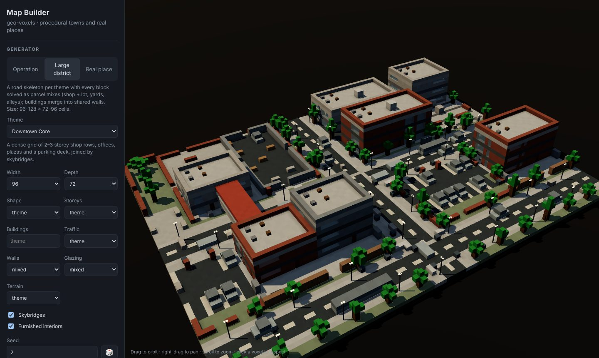
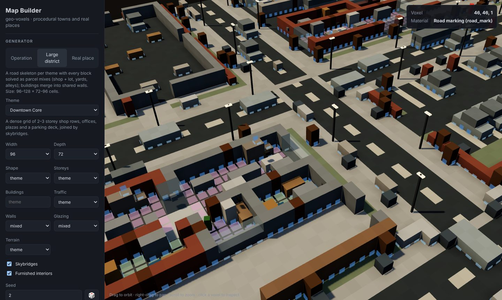
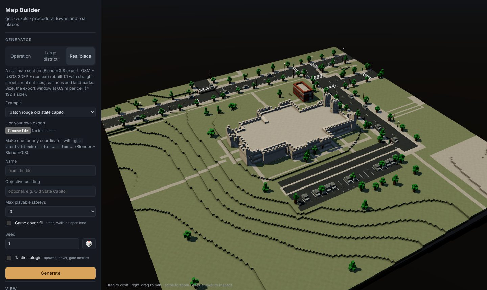

# geo-voxels

**A voxel map builder for games: procedural towns and real places.** Generate a town district from a theme and a
seed, or rebuild a real map section from OpenStreetMap and USGS terrain, and get a furnished voxel map — buildings with
rooms, doors, stairs and furniture, streets with paint, props — as plain data any engine can load. Three ways in: a
**Three.js app** to generate, inspect and export maps; a **CLI**; and a **JavaScript library** (Node ≥ 20 or the
browser, no runtime dependencies).



| Floor cutaway, rooms and the tactics overlay | A real place: the Old State Capitol, Baton Rouge |
|---|---|
|  |  |

## Generators

| Generator | Themes | What it builds |
|---|---|---|
| `operation` | `downtown` · `industrial` · `suburb` | An XCOM-style plot (≈ 56 × 48 cells): a road layout per theme, parcels (lots, alleys, yards, plazas) and 1–4 storey buildings solved on it with wave-function collapse, a subway or storm drain beneath, repaired until it passes the design gates. |
| `district` | `park` · `mall` · `drainage` · `suburb` · `downtown` · `docks` · `highway` · `terraces` · `sunken-junction` · `sunken-boulevard` · `freight-terraces` | A large district (96–128 × 72–96): a road skeleton per theme, every block solved as parcel mixes (shop + its lot, houses + drives + yards, warehouses + aprons), buildings merged through shared walls, skybridges, split levels. Width, depth, shape (rectangle / L / T), storeys, building count, traffic, walls, glazing and terrain are parameters. |
| `place` | any coordinates | A real map section (Blender + BlenderGIS export: OSM, USGS 3DEP, one Overpass + ≤ 2 Wikidata requests of context) rebuilt 1:1 with straight grid streets, real outlines, real uses and tenants (each gets the matching interior), landmarks from OSM 3D parts or their style, real trees and street furniture. |

Every building is built by the same builder: rooms planned per program (shop, diner, office, house, warehouse, garage,
motel, bank, museum, chapel, civic, school, library, clinic, hotel, supermarket …), shared party walls, doors, windows,
stairs, fire escapes and ladders, furnished room by room. The same seed always gives the same map.

## The Map Builder app

```sh
git clone https://github.com/Dankcode/Geo-voxels && cd Geo-voxels
npm install
npm run app            # → http://localhost:5180
```

Pick a generator and theme (or one of the example places, or drop in your own `blender-export.json`), set a seed and
the parameters, **Generate**. The map is built in a web worker and drawn with ambient occlusion and shadows. Orbit, pan
and zoom; drag the **floor cutaway** to look into the storeys; toggle props, road paint, rooms (tinted by kind) and —
with the tactics plugin — cover and spawns; click any voxel to see its material, building, use and room. Export
`.vox` (MagicaVoxel, and the Blender / Godot / Unity / Unreal importers), `.glb` (the mesh as shown), `map.json`
(buildings, rooms, doors, stairs, props, road paint, meta), `grid.json` or a screenshot. The URL keeps generator, theme
and seed, so a map is a link. `npm run app:build` writes a static site to `dist-app/`.

## CLI

```sh
node bin/geo-voxels.mjs list                                   # generators, themes, parameters
node bin/geo-voxels.mjs generate --generator district --theme downtown --seed 2 --out out/downtown
node bin/geo-voxels.mjs generate --generator operation --theme industrial --seed 4 --tactics --out out/yard
node bin/geo-voxels.mjs generate --generator place --geo examples/baton-rouge-third-street/blender-export.json \
     --params '{"name":"Third Street","coverRepair":false}' --prefabs --name third-street --out out/third-street
# → map.vox, grid.json, map.json, slate.png (+ prefabs/<building>.json for --prefabs)
```

## Library

```js
import { generate, tactics, toVoxBytes } from 'geo-voxels';

const map = generate({ generator: 'district', theme: 'suburb', seed: 2, params: { width: 112, remix: { maxStoreys: 2, traffic: 'light' } } });
map.grid;               // VoxelGrid: width × depth × height, one byte per voxel (x east, y south, z up), .palette
map.palette;            // [{ id, key, label, color: [r, g, b], solid, opaque, glass, walkable, family, light }]
map.layers.buildings;   // [{ id, name, program, x0, y0, w, d, baseZ, storeys, doors, windows, stairs, exits, rooms }]
map.layers.rooms;       // [{ id, buildingId, storey, kind, cells: [[x, y]], floorZ }]
map.layers.decor;       // [{ kind, x, y, z, yaw }] — street lights, signals, awnings, furniture … for your prop models
map.layers.roadPaint;   // { quads: [{ c: [[x, y] ×4], z, color }] } (real places)
toVoxBytes(map.grid);   // Uint8Array .vox

const battle = generate({ generator: 'operation', theme: 'downtown', seed: 9, plugins: [tactics()] });
battle.plugins.tactics; // { spawns, objective, cover: [[x, y, z, n, e, s, w]], metrics: { coverGap, lanes, … } }
```

**Plugins** run on the finished map and add to `result.plugins[name]`. `tactics()` keeps the turn-based rules the
engine was built for — player and enemy spawns, the objective, XCOM-style half/full cover per tile and the design-gate
metrics (cover density, largest open gap, sightlines, lanes, breachability). Without it a map is just a map. (The
generators still place cover-worthy real objects as part of their recipe; for real places `params.coverRepair: false`
leaves open land exactly as mapped.)

**Building prefabs**: `bakePlacePrefabs(generate({ …, engineMap: true }).engine, { place })` turns every real building
into a prefab (voxels, rooms, doors, stairs, decor); `stampPrefab` / `placePrefabInLot` drop one into another map,
rotated or mirrored, facing a chosen street.

## The town engine

`engine/` is the map generation of [voxel-tactics](https://github.com/Dankcode/voxel-tactics) (a turn-based tactics game
in Three.js), copied verbatim with its folder layout by `tools/sync-engine.mjs` — the import closure of the generators,
79 files. `engine/SOURCE.json` records the commit and a hash per file; `npm run engine:check -- <checkout>` tells
whether the copy still matches the game. A map generated here is voxel-identical to the same map in the game.
[docs/ENGINE.md](docs/ENGINE.md) walks through the generators.

## Real places

**Real places → straight-street voxel maps.** Fetch a map section (OpenStreetMap buildings, streets, land use and USGS
3DEP bare-earth terrain) through [BlenderGIS](https://github.com/domlysz/BlenderGIS) in Blender, then rebuild it at 1:1
as a voxel grid where every street is an exact grid line, every building wall lies on the grid and every height step
runs straight across the road — no ragged pixel staircases from roads that were a few degrees off north. Two builders
share the method: `generate({ generator: 'place' })` (the town engine: interiors, props, road paint) and the light
`buildPlace` (`src/build.js`: shells and layers only, any size, fast).

| Raw OSM geometry on a voxel grid | Straightened (`straighten: 'grid'`, the default) |
|---|---|
|  |  |
|  |  |

*Sherwood Forest Blvd × Florida Blvd and Third Street, Baton Rouge (examples/). Florida Blvd really meets Sherwood at
about 79°; on the straightened map it is 90° and the shopping centre slides with it.*

| Old State Capitol, Baton Rouge (Gothic Revival, lawn and paths) | Independence Hall, Philadelphia (tower from OSM 3D parts) |
|---|---|
|  |  |

- **Faithful where it matters.** Real outlines (wings cut at reflex corners), real streets with lane widths, slip lanes,
  divided carriageways, real terrain (3DEP DTM, not a surface model), car parks — and strip-centre car parks inferred
  where OSM only maps retail land.
- **Context, not scraping.** One Overpass request (tenants, amenities, OSM 3D building parts, street furniture) and at
  most two Wikidata requests (floors, height, style, year, architect, heritage) per place: each building gets its real
  use and tenants, landmarks rise to their mapped parts with their roof shapes, real trees stand where they are mapped.

```sh
node bin/geo-voxels.mjs build examples/baton-rouge-sherwood-florida/blender-export.json --out out/sherwood
# → out/sherwood/map.vox, grid.json, layers.json, slate.png, report.json (the light builder)
```

## Fetching a new place (Blender + BlenderGIS)

1. Install Blender (4.x/5.x) and the BlenderGIS add-on; put your [OpenTopography](https://opentopography.org) API key in
   the add-on preferences (the key is read there — never put it in a script or repo).
2. Pick the map window in metres around a point (≤ ~230 m a side at 0.9 m cells for MagicaVoxel's 256 limit):
   ```sh
   node bin/geo-voxels.mjs blender --lat 30.4583 --lon -91.0587 --window -100,71,-97,74 --pad 30 --out ./out/place
   ```
   and run the printed Python in Blender (Scripting tab, or a Blender MCP `run_blender_python` call). It runs in the
   background (Blender stays responsive), fetches DEM and OSM for the window **plus `pad` metres on every side**, and
   writes `blender-export.json` (with a `context` block) + a top-down reference render. `context_only(out)` adds the
   context to an older export without re-fetching anything else. Overpass mirrors are retried; `resume(out, 'osm')`
   re-runs only the OSM stage.
3. `node bin/geo-voxels.mjs generate --generator place --geo out/place/blender-export.json --out out/place/map` (or open the
   export in the app; `build` for the light builder).

Use `dem='USGS10m'` (3DEP, US, bare earth) wherever it exists. `SRTMGL1` is a *surface* model — buildings bleed into it
(downtown Baton Rouge read 21–46 m on SRTM vs 14.5–16.1 m on 3DEP).

## The method

[docs/METHOD.md](docs/METHOD.md) explains every stage. In short:

1. **Frame** — rotate by the length × class weighted 4θ mean of street segments and building walls, crop to the window
   (the padded fetch means a rotated window has real data in its corners), one uniform scale.
2. **Straighten** — Douglas–Peucker the centrelines (junctions pinned), snap each segment to an axis (true diagonals
   become an L), tie shared coordinates by union-find and solve them as the weighted least-squares mean, keeping
   parallel carriageways in order; rubber-sheet buildings and land use along; square each outline to the grid.
3. **Footprints** — rasterise, one party wall between touching buildings, cut into wing rectangles at reflex corners.
4. **Streets** — box (L∞) distance gives square road ends and corners; junction squares belong wholly to the longer
   street (nearest-wins would split them diagonally).
5. **Lots and open land** — mapped parking, implied strip-centre car parks (retail land only) with a storefront walk and
   stall rows per section; parks and grass are lawn, named plazas paved, footpaths straight paved walks.
6. **Terrain** — DTM → whole-voxel heights; buildings, lots and *each street segment* are level plateaus, touching
   plateaus ≤ 1 step apart, the rest relaxed — so height steps run straight across streets.
7. **Voxels** — ground, surfaces, shells (storeys, glazing, doors facing the street or the car park, roof, parapet),
   OSM 3D parts above the shell at their real heights with their roof shapes, real trees.
8. **Paint** — a road-paint plan (centre/lane/edge lines, stop bars, crosswalks) as quads for the renderer.

## Layout

```
app/                            Map Builder (Vite + Three.js): index.html, src/main.js, worker.js, mesher.js, props.js
engine/                         the town engine (synced from voxel-tactics; SOURCE.json)
src/town.js                     generate(): one entry point for every generator, engine map → MapResult
src/plugins/tactics.js          tactics plugin (spawns, cover, gate metrics)
src/vox.js                      .vox writer (browser + Node)
skill/voxel-map-builder/        Claude skill: make maps with this repo in any project
tools/sync-engine.mjs           copy / check the engine against a voxel-tactics checkout
blender/blender_geo_import.py   Blender stage (BlenderGIS OSM + DEM, padded window, status file, resume)
src/frame.js                    frame, rasterisation, DEM → heightfield, plateaus + relaxation
src/rectify.js                  street straightening, rubber sheet, outline squaring
src/footprint.js                outline → wings, party walls
src/osm.js                      OSM tag rules (street classes/widths, slip lanes, storeys, use)
src/context.js, src/uses.js     tenants, uses, 3D parts, Wikidata facts, street furniture per building
src/roadPaint.js                road-paint plan from the road graph
src/build.js                    buildPlace: every stage in order
src/grid.js, src/export.js      VoxelGrid, MagicaVoxel .vox, PNG slate
bin/geo-voxels.mjs              CLI
examples/                       Baton Rouge (Third Street, Sherwood & Florida, Old State Capitol) and Philadelphia
                                (Independence Hall) exports with context (OSM + Wikidata + USGS, see DATA.md)
```

## References

- D. Lysz, [BlenderGIS](https://github.com/domlysz/BlenderGIS) — OSM and DEM import into Blender.
- [OpenTopography API](https://portal.opentopography.org/apidocs/) — USGS 3DEP (`usgsdem`) and global DEMs.
- M. Sester, *Generalization based on least squares adjustment*, IAPRS XXXIII-B4 (2000) — least-squares map generalisation.
- S. Cabello, M. de Berg, M. van Kreveld, *Schematization of networks*, Comput. Geom. 30 (2005) — rectilinear schematisation.
- A. Saalfeld, *Conflation: automated map compilation*, IJGIS 2(3) (1988) — rubber-sheeting.
- D. Camozzato et al., *Procedural floor plan generation from building sketches* (2015) — outline → wings.
- M. Gumin, [WaveFunctionCollapse](https://github.com/mxgmn/WaveFunctionCollapse) (2016) — the constraint solver behind parcel and building choices.
- D. Douglas, T. Peucker, *Algorithms for the reduction of the number of points…* (1973).

## Licence

Code: MIT ([LICENSE](LICENSE)). Example data: © OpenStreetMap contributors (ODbL) and USGS 3DEP (public domain) — see
[DATA.md](DATA.md). BlenderGIS (GPL-3.0) is a separate install; this repo only calls it.
