# Map Interior Generator

*Formerly Geo-voxel. The repository is being renamed to `map-interior-generator`.*

**Real map data → buildings you can walk into.** Pick any place on Earth. Map Interior Generator reads what open data says about
each building there: its outline, its use, its storeys, the street it faces, the neighbours it shares walls with and,
where one exists, its public record. From that it generates the inside: a room programme, a floor plan for every
storey, doors, windows, stairs, a roof and furniture, all checked against building-code rules. You get BIM models
(IFC4), a JSON file per building for game engines, blueprints, and furnished voxel maps of whole streets.

The floor plans follow Merrell, Schkufza & Koltun, *Computer-Generated Residential Building Layouts* (SIGGRAPH Asia
2010), adapted to a harder case: the outline is fixed by the map, not designed. Generation is deterministic and uses
no AI model.

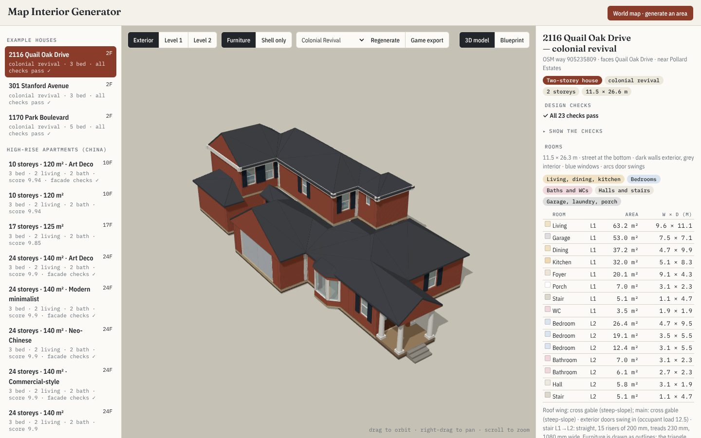

*2116 Quail Oak Drive, Baton Rouge, generated from its OpenStreetMap footprint and its public record (3 bedrooms,
1,838 sq ft). Right: all 23 design checks pass, and every room with its area and size.*

> **Status — moving to 3D modelling only.** The project began as the map generator of a voxel tactics game. The voxel
> maps, the town engine and every game rule are moving to the game's repository (voxel-tactics), which converts
> this project's downloads into voxels with its own converter. Map Interior Generator keeps the map-to-model side: planned buildings
> and interiors in FreeCAD/IFC4, area scenes in Blender/glTF, and an installable Python package. Until that lands, the
> voxel sections below still describe the code in this repository. See
> [PLAN-geo-voxel-02](docs/plans/PLAN-geo-voxel-02.md).

## What you get

| Output | Per | Format | Opens in |
|---|---|---|---|
| Building model | building | IFC4, FreeCAD `.FCStd` | FreeCAD BIM, Blender (Bonsai), IfcOpenShell, other IFC tools |
| Game export | building | `building-export@1` JSON: rooms, doors (which rooms they join, facing, swing), windows, stairs, furniture, garage, in local metres and lat/lon | any engine |
| Blueprint | storey | SVG in the house viewer | browser |
| Gate report | building | JSON: every design check and its result | — |
| Voxel map | street (30–172 m) | `.vox`, `.glb`, `map.json`, `grid.json` | MagicaVoxel, Blender, Godot, Unity, Unreal |

## Who it is for

| You are | What Geo-voxel gives you | Start at |
|---|---|---|
| **A game or simulation developer** who wants real places with enterable, navigable buildings | one JSON per building with a room graph, door facings and a frame to place it; meshes through IFC → glTF | [docs/INTEGRATE.md §1](docs/INTEGRATE.md#1-games-and-simulations-the-building-export) |
| **A voxel artist or voxel-game developer** | whole streets as `.vox`, with straight streets, terrain, signs and rooms | [§2](docs/INTEGRATE.md#2-voxel-maps-of-whole-streets) |
| **An AEC, BIM or digital-twin builder** | code-checked, typed IFC4 interiors for buildings that only exist as outlines in the map | [§3](docs/INTEGRATE.md#3-bim-and-digital-twins-ifc4) |
| **A researcher in procedural or architectural generation** | a full, reproducible reimplementation of Merrell et al. on real footprints, with ablations, a design gate, a scorecard and a fixed test set | [docs/FINDINGS.md](docs/FINDINGS.md), [§5](docs/INTEGRATE.md#5-porting-the-method) |
| **A mapper, planner or teacher** | a way to see what typical buildings in a place are like inside, with every inferred choice explained | the house viewer |

Generated interiors are plausible and code-checked. They are not surveys of the real buildings; say so wherever you
show them.

## Quick start

**Browse.** Open the house viewer (`https://dankcode.github.io/Geo-voxel/houses/`, or `npm run app` locally). Browse
the example houses and high-rises, or open **World map**, go to any place, highlight 1–2 blocks and press **Request
generation**. The viewer shows the command that generates those houses; generation runs on your own computer, so
FreeCAD and the other [requirements](#requirements) must be installed. Each building has a 3D view, blueprints, its
checks and a **Game export** button.

**Voxel maps in the browser:**

```sh
git clone https://github.com/Dankcode/Geo-voxel && cd Geo-voxel
npm install
npm run app            # → http://localhost:5180 (Place Builder) and /houses/ (house viewer)
```

**Houses on your own machine** (needs the [requirements](#requirements)):

```sh
micromamba create -f architecture/environment.yml && micromamba activate houses
bash architecture/pipeline/roofgen/build.sh
python architecture/pipeline/run_request.py --lat 30.4425 --lon -91.1659 --blocks 1.5     # plan, check, model, rebuild the viewer
python architecture/pipeline/run_request.py --restyle <area> <building key> craftsman     # same rooms, another style
```

### Requirements

| Requirement | Version | Used for | Install |
|---|---|---|---|
| **FreeCAD** (required) | 1.0 | BIM models (`.FCStd`), IFC4 export and the viewer meshes (`bim.py`, `highrise/bim.py`) | `architecture/environment.yml` (conda-forge `freecad=1.0`) or [freecad.org](https://www.freecad.org/downloads.php) |
| **CGAL** (required) with GMP and MPFR | CGAL ≥ 6.0 | roofs from the weighted straight skeleton (`roofgen/`) | `architecture/environment.yml`, then `bash architecture/pipeline/roofgen/build.sh` |
| C++17 compiler | | building `roofgen` | `architecture/environment.yml` (`cxx-compiler`), Xcode command-line tools or `g++` |
| Python | 3.11 | the planner, checks, openings, furniture, blueprints | `architecture/environment.yml` |
| numpy, scipy, shapely ≥ 2, ifcopenshell, lark, matplotlib | | as above | `architecture/environment.yml` or `pip install -r architecture/requirements.txt` |
| Node.js | ≥ 20 | the viewer and Place Builder (`npm run app`), the JS library and its tests | [nodejs.org](https://nodejs.org) |
| Blender (optional) | ≥ 4.2 | importing the map and models into Blender (`blender/blender_geo_import.py`) | [blender.org](https://www.blender.org/download/) |

`run_request.py` checks for FreeCAD, the roof tools and the Python packages before it starts and says what is missing.
A browser alone can view and export the buildings that are already generated; generating or restyling needs these.

[docs/INTEGRATE.md](docs/INTEGRATE.md) explains how to use each output in your own project: coordinate frames,
building a navigation graph, engine axes, IFC conversion, forking the generator, and the licences.

### Build your own with an AI agent (FreeCAD or Blender MCP)

An MCP server lets an AI agent (Claude Code, Claude Desktop, Codex, Cursor and others) drive FreeCAD or Blender while it
runs this repository's generator on your computer. The generator itself never asks a model anything: the agent runs
the same `run_request.py` commands the viewer shows, then opens the result in FreeCAD or Blender so you can look at it
and change it together.

**FreeCAD** ([neka-nat/freecad-mcp](https://github.com/neka-nat/freecad-mcp), MIT):

1. Install the requirements above (FreeCAD 1.0 comes with `architecture/environment.yml`; the desktop FreeCAD app is
   needed too, because the MCP add-on runs inside its window) and [uv](https://docs.astral.sh/uv/).
2. Install the add-on into FreeCAD's `Mod` folder and restart FreeCAD:
   ```sh
   git clone https://github.com/neka-nat/freecad-mcp.git
   cp -r freecad-mcp/addon/FreeCADMCP ~/.FreeCAD/Mod/      # the Mod folder moves by OS and FreeCAD version; see that README
   ```
3. In FreeCAD pick the **MCP Addon** workbench and press **Start RPC Server** (or tick **Auto-Start Server** in its menu).
4. Register the server with your agent, from this repository's folder:
   ```sh
   claude mcp add freecad -- uvx freecad-mcp                # Claude Code
   ```
   For Claude Desktop add `"freecad": {"command": "uvx", "args": ["freecad-mcp"]}` under `mcpServers` in
   `claude_desktop_config.json` (Settings → Developer → Edit Config) and restart it.

**Blender** ([ahujasid/blender-mcp](https://github.com/ahujasid/blender-mcp), MIT):

1. Install Blender 4.2 or newer and [uv](https://docs.astral.sh/uv/).
2. Install the add-on: `uvx blender-mcp install-addon`, then in Blender enable **Interface: Blender MCP**
   (Edit → Preferences → Add-ons) and press **Start MCP Server** in its sidebar tab (N in the 3D view).
3. Register the server: `claude mcp add blender uvx blender-mcp` (Claude Code), or
   `"blender": {"command": "uvx", "args": ["blender-mcp"]}` in `claude_desktop_config.json`.
4. For the generated models, enable the [Bonsai](https://bonsaibim.org) add-on (IFC for Blender): the agent loads a
   building's `.ifc` with it. `blender/blender_geo_import.py` brings in the terrain and the OpenStreetMap context.

**Then ask the agent**, in this repository's folder, for example:

- "Generate the houses within 1.5 blocks of 30.4425, −91.1659 and open the first one in FreeCAD." The agent runs
  `python architecture/pipeline/run_request.py --lat 30.4425 --lon -91.1659 --blocks 1.5` and opens
  `architecture/areas/<area>/deliver/bim/<key>.FCStd`.
- "Regenerate Stanford Avenue with four bedrooms upstairs and a study downstairs." The agent copies or builds the
  command from the viewer's **Regenerate** panel (`--regenerate examples stanford-s3 --rooms '{"1": {"bedroom": 4}, "0": {"study": 1}}'`).
- "Make the 24-storey tower six flats per floor and show me a typical floor in Blender." (`--highrise hr24-140 --dwellings 6`,
  then the `.ifc` from `architecture/highrise/buildings/<id>/`.)

Edits you make by hand in FreeCAD or Blender stay in those files. To keep a change in the generator's own output, regenerate
with different counts or a different style, or move furniture with the furniture editor MCP
([architecture/pipeline/furnmcp](architecture/pipeline/furnmcp/README.md)), which the build replays with `FURN_EDIT=1`.

## How to use it

Browsing, the blueprints and the exports work in any browser. Generating, regenerating and restyling run on your own
computer with FreeCAD (see [Requirements](#requirements)): the viewer shows the command to run, or your AI agent runs it
for you ([Build your own with an AI agent](#build-your-own-with-an-ai-agent-freecad-or-blender-mcp)).

### 1. Pick a building

Press **☰ Buildings list** (top left) to open the list of every generated building: the example houses, each
generated area, your regenerated buildings and the high-rise apartments. Click one to load its 3D model; the list
closes again. The panel on the right says what the map told us about it (OSM way, the
street it faces, the public record), what was planned (storeys, bedrooms, style), a one-line result of the design
checks (**Show the checks** opens the full list; it opens by itself when a check fails) and a table of every room
with its area and size. Drag to orbit, right-drag to pan, scroll to zoom.

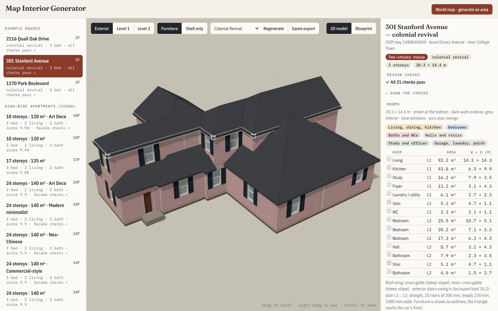

### 2. Look inside

**Level 1** and **Level 2** cut the model at that floor, so you look into the rooms from above. **Furniture** shows
the furnished rooms; **Shell only** shows the bare walls, doors, windows and stairs. Buildings with more than five
floors get a compact floor picker instead of a button per floor (see step 6), and on every building the **[** and
**]** keys (or Page Down and Page Up) step down and up through the floors.

| Level 1, furnished (2116 Quail Oak Drive) | Level 2 (301 Stanford Avenue) |
|---|---|
| 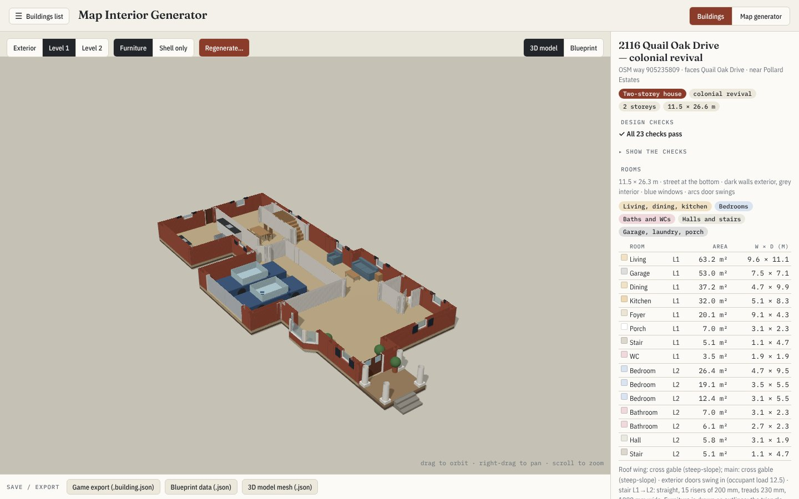 | 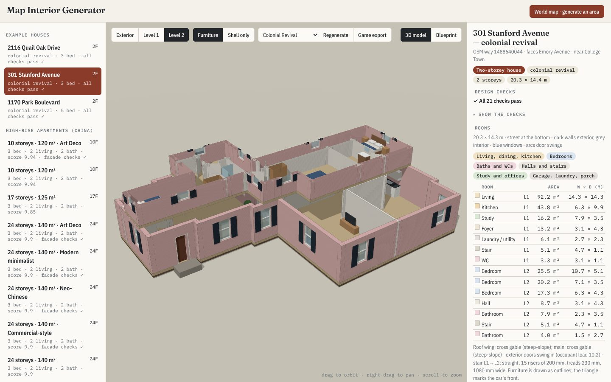 |

### 3. Read the blueprint

**Blueprint** (top right) draws every storey from the generated geometry: thick walls are exterior, thin ones
interior, blue lines are windows, arcs are door swings, the arrow is the stair, and the street is at the bottom of each
sheet. Point at a room to see its name and size. Consecutive floors with the same plan are drawn once, so a
24-storey block shows two sheets ("Level 1" and "Levels 2–24 · 23 identical floors"), not 24.

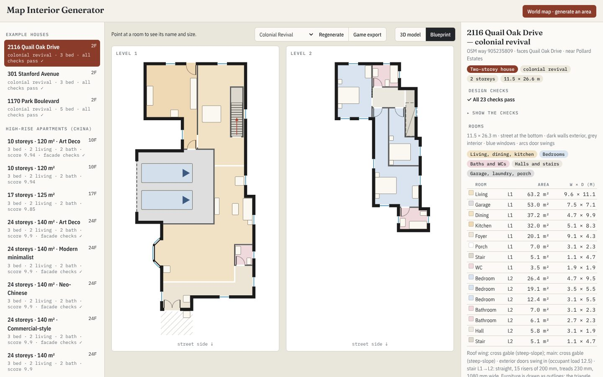

### 4. Generate a new area

1. Open the **Map generator** tab (top right; **Buildings** brings you back). Drag to move around the map, scroll
   or pinch to zoom.
2. Go to a place: one of the bundled areas, or type an address, a place name or a latitude and longitude and press
   **Go**. Bundled areas draw at once; anywhere else loads OpenStreetMap live.
3. Click the map to centre the area, and set the radius (1–2 blocks; one block is about 110 m). The houses inside
   turn red and are listed on the right, nearest first; the nearest 12 are generated.
4. Choose a style for the whole area, or one per house (**Inferred per house** lets the map decide).
5. Press **Request generation**. The viewer shows the `run_request.py` command for that area, with a **Copy command**
   button. Run it in the repository folder (or ask your CLI agent to); it plans, models and checks the houses on your
   computer with FreeCAD and rebuilds the viewer, which then lists the new area. See [Requirements](#requirements).

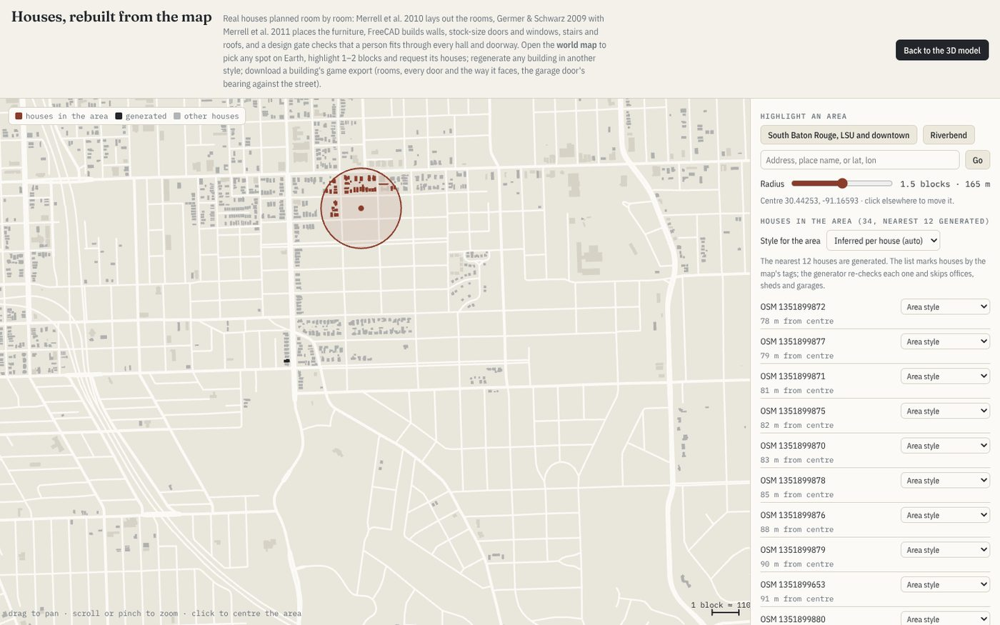

### 5. Regenerate a building, then save it

**Regenerate…** (in the toolbar above the model) works on every building on the list, the example houses and the
high-rises included, and on buildings you have already regenerated:

- **Houses:** set the storeys (1 or 2), the bedrooms, bathrooms, study and WC on each floor, the garage (none, 1 or 2
  cars) and the style. **Regenerate** plans the house again from its map footprint with those counts (the same
  planner, checks and FreeCAD build) and adds it to the list next to the original as "regenerated, N bed".
  **Restyle only** keeps the rooms and changes the style template (Merrell 2010 Fig. 9: Cottage, Italianate, Tudor,
  Craftsman and 16 more).
- **High-rises:** set the storeys (7–40), the flats per floor (2, 4 or 6, all on one core), the flat size, bedrooms,
  bathrooms and the facade. With 4 or 6 flats a floor the size sets the footprint (that of the 2-flat slab) and the
  floor is split into compact flats.

The panel shows the `run_request.py` command with a **Copy command** button: run it in the repository folder, or
let your AI agent run it, and reload the viewer. A regenerated house keeps the original's other programme choices
(porch, dining room, laundry); the layout search tries 3 seeds and keeps the first that passes every check, or the one
with the fewest failures, which the viewer then lists as "checks fail". Add `--tries 6` to search longer.

The **Save / export** bar along the bottom of the model saves the building:

- **Game export:** the `building-export@1` JSON (houses): rooms, every door with the two rooms it joins and the
  bearing it faces, windows, stairs, furniture and the garage. See
  [docs/INTEGRATE.md](docs/INTEGRATE.md#1-games-and-simulations-the-building-export).
- **Blueprint data:** every storey's rooms, walls, doors, windows and furniture outlines, in metres.
- **3D model mesh:** the coloured triangles the viewer draws.
- **IFC4 and FreeCAD models** for BIM tools are written on your computer when you generate: in
  `architecture/areas/<area>/deliver/bim/` (houses) and `architecture/highrise/buildings/<id>/` (high-rises).

### 6. High-rise apartments

The high-rise section of the list holds Chinese residential slabs from 10 to 34 storeys, planned dwelling by dwelling
against the Chinese codes. The same plan can wear four facades; the storey count decides the core, the exits and the
refuge floors. A floor has 2, 4 or 6 flats around one lift-and-stair core, inside the same length and depth as the
2-flat slab of that flat size: with 4 or 6 the floor is split into compact flats instead of growing longer. The whole
floor is planned in one search, as the houses are: the core (stair, fire lobby, lifts) moves along the north facade
and the corridor and flats grow around it. The lifts and every flat door open onto one public corridor; only the
stair's fire lobby has a fire door. Every flat keeps a south-facing room and daylit living room, bedrooms and kitchen, so 6 flats need the
footprint of the 2-flat slab of about 185 m² flats (the example uses 190 m²). Every room is checked on its
real shape for a person to walk through (0.9 m clear, the entry 1.1 m, halls 1.0 m); where a neighbouring room's corner
pinches the way, the planner cuts that corner off at 45°, as Chinese plans often do at entries and hall turns.

Pick a floor with **▾ Floor N of 24 ▴** in the toolbar (or **[** and **]**): the view cuts the tower at that floor and
zooms to it, so you see the two furnished dwellings and the core. **Exterior** returns to the whole building.
Every dwelling is furnished by the same solver as the houses: bedrooms, living and dining rooms, kitchens,
bathrooms, and a washer on each balcony.

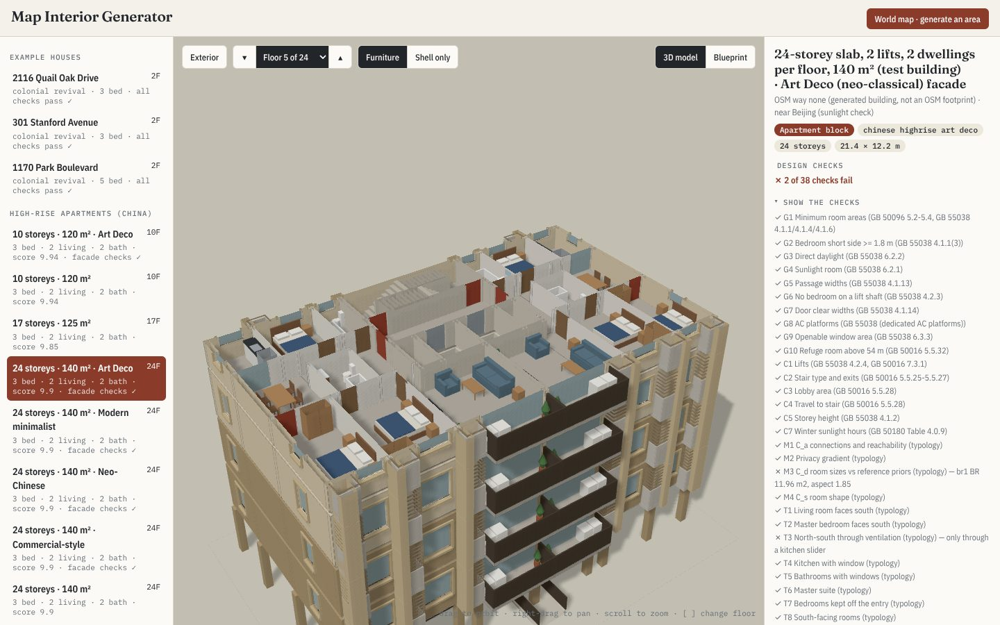

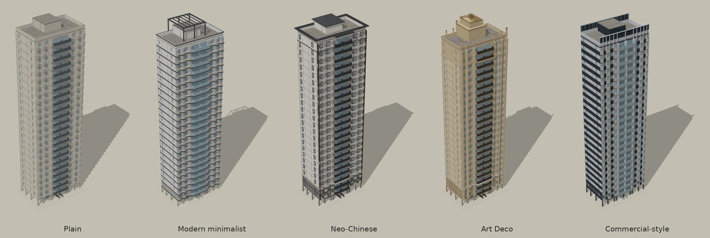

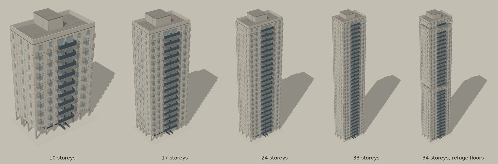

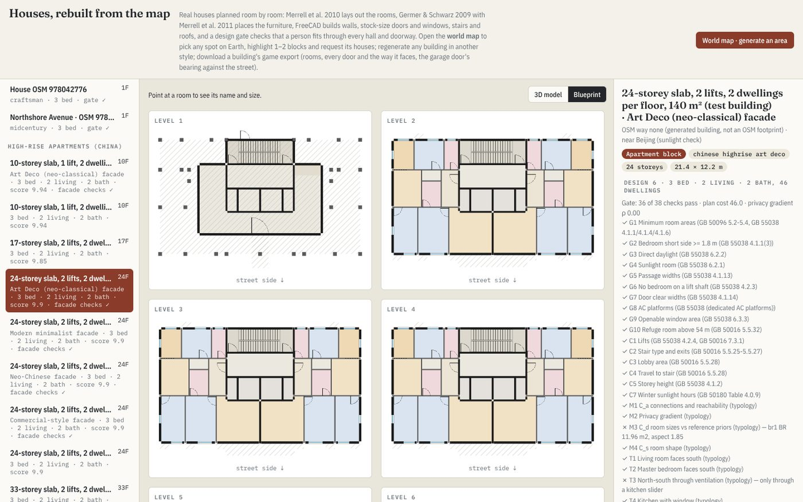

### On a phone

The same page works on a phone: the toolbar sits in its own row above the model, the details follow it, and the
building list opens from **☰** as on a computer. Nothing covers the model.

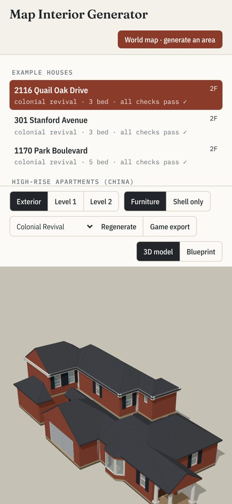

## What is new here

The full discussion, with formulas and evidence, is in [docs/FINDINGS.md](docs/FINDINGS.md). In short:

1. **Fixed outlines turn the paper inside out.** Merrell et al. design the outline; on a map it is given. Daylight,
   the street entry and garage access become constraints on particular edges of the footprint.
2. **Fidelity to the paper beats improvements to it.** Each of our departures (normalising the corner count, exempting
   halls from the dimension term, adding non-paper terms to the objective, testing windows at one point) produced a
   specific defect: irregular rooms, 70 m² halls, stairs that go nowhere, roofs that don't meet. Restoring the paper's
   terms fixed each one.
3. **Adjacency is not access.** The paper's accessibility term passes plans joined through a 0.4 m neck. We test
   circulation by morphological erosion with a 914 mm disc, $W_d = \Omega \ominus B_{d/2}$, on the real wall solids,
   and charge narrow strips inside the optimiser.
4. **On a fixed outline the start state decides what is reachable.** A street-to-back "rows" start (public row, hall
   spine, private row, small rooms attached to their parent) plus programme edges relaxed to classes doubled the pass
   rate (7 → 14 of 25) and cut missing connections from 20 to 5.
5. **A footprint is not a house size.** OSM outlines include garages and patios; calibrating rooms on public records
   took a modelled 4,736 sq ft five-bedroom house back toward its recorded 1,838 sq ft and three bedrooms.
6. **Design in vectors, voxelise last.** At 0.9 m voxels a typical room loses about 40% of its area to one-cell walls;
   $A_{\text{vox}}/A \approx (1 - (c - t)/a)^2$ predicts the measured 37–46%. At 0.3 m the loss is 9–18%.
7. **An independent rebuild catches what self-checks miss.** Rebuilding every design in a second BIM modeller found
   walk-through bedrooms and a hall merged with a stair that our own gate had passed.
8. **For high-rises, height decides the plan.** With 3.0 m storeys, $n_{\max} = \lfloor (H^\ast - 0.3)/3 \rfloor$ puts
   Chinese code thresholds at 10, 17 and 33 storeys; the core, exits and refuge floors follow from the storey count.

## How it works

### Buildings (`architecture/`)

```
OpenStreetMap footprint + tags, neighbours, streets, land use, historic districts, Wikidata, public records
  → frame       walls axis-aligned, front toward the street, party walls marked          (mapctx.py)
  → theme       archetype, era and style, each with its evidence                          (theme.py)
  → programme   rooms, area and aspect priors, tiers, edge classes                        (programs.py, house_facts.py)
  → plan        Metropolis–Hastings on a 0.4 m label grid per storey                      (planner.py)
  → gate        21 checks on the built walls; restart until one passes                    (blueprint.py, circulation.py)
  → compile     doors near corners with swings, windows, stairs, straight-skeleton roofs  (doors2.py, openings.py, stairs.py, roofs.py)
  → furnish     legal poses proposed, Merrell 2011 cost chooses                            (furnish2.py)
  → outputs     FreeCAD/IFC4 model, blueprint, gate report, game export                   (bim.py, export_game.py)
```

The plan minimises the paper's cost, with every room in the dimension term and the raw corner count in the shape term:

$$C = k_a C_a + k_d C_d + k_s C_s + k_f C_f + k_o \sum_i \big(e(F_i) - 4\big),\qquad
M_c(S) = \frac{A(H(S)) - A(S)}{A(S)} + \big(e(S) - 4\big)$$

with $k_a = 100$, $k_d = 1.5$, $k_s = 1$, $k_f = 1000$, $k_o = 0.6$, and acceptance $\min(1, e^{-\beta\Delta C})$ as
$\beta$ rises from 0.03 to 6. [architecture/README.md](architecture/README.md) documents the house pipeline,
[architecture/highrise/README.md](architecture/highrise/README.md) the high-rise apartments.

### Voxel maps (`src/`, `engine/`, `app/`)

1. **Frame**: rotate by the length-weighted $4\theta$ mean of street and wall directions,
   $\theta = \tfrac14\,\mathrm{atan2}\big(\sum w L \sin 4\alpha,\ \sum w L \cos 4\alpha\big)$, which treats
   directions 90° apart as one.
2. **Straighten**: simplify centrelines (junctions pinned), snap segments to axes, tie shared coordinates by
   union-find and solve each as a weighted least-squares mean, then rubber-sheet buildings and land use along.
3. **Build**: footprints into wings, streets by box distance, lots, terrain plateaus, shells with rooms and furniture,
   OSM 3D parts and roof shapes, trees, signs, road paint.

[docs/METHOD.md](docs/METHOD.md) covers every stage; [docs/ENGINE.md](docs/ENGINE.md) maps the engine.

## Where the data comes from

| Source | What it gives |
|---|---|
| **OpenStreetMap** (Overpass, keyless) | building outlines and tags, streets, land use, tenants, 3D building parts, entrances, house numbers, street furniture |
| **AWS Terrain Tiles** | terrain (USGS 3DEP bare earth in the US, SRTM-class elsewhere) |
| **Wikidata, Wikipedia, Commons** | landmark facts (floors, height, style, year, architect, heritage), brand colours, documentation and photo references |
| **Public property records** | living area, bedrooms, baths and garage bays for the example houses; each design cites its sources |

Credit them when you ship anything built from them: © OpenStreetMap contributors (ODbL), USGS 3DEP (public domain),
Wikidata (CC0), Wikipedia (CC BY-SA), Commons per photo. See [DATA.md](DATA.md).

## Repository layout

```
architecture/pipeline/     house pipeline (Python): planner, gate, FreeCAD/IFC, game export, area generation
architecture/highrise/     Chinese high-rise apartments: codes, core, dwelling planner, sunlight, facades
architecture/areas/        generated areas: plans, exports, IFC models, gate reports
architecture/data/         bundled OpenStreetMap extracts (Baton Rouge)
architecture/viewer/       house viewer source; build_viewer.py → app/public/houses/
app/                       Place Builder (Vite, Three.js, Leaflet) and the published viewer
src/                       voxel map library: live fetch, frame, straighten, footprints, details, .vox export
engine/                    town engine: buildings, rooms, furniture, terrain, voxels
bin/geo-voxels.mjs         CLI for voxel maps
blender/                   optional Blender/BlenderGIS fetch stage
docs/                      FINDINGS, INTEGRATE, METHOD, ENGINE, plans/, research/
.github/                   request forms and the generate-houses and Pages workflows
```

## References

- P. Merrell, E. Schkufza, V. Koltun. *Computer-Generated Residential Building Layouts.* ACM TOG 29(6), 2010.
- P. Merrell, E. Schkufza, Z. Li, M. Agrawala, V. Koltun. *Interactive Furniture Layout Using Interior Design
  Guidelines.* ACM TOG 30(4), 2011.
- T. Germer, M. Schwarz. *Procedural Arrangement of Furniture for Real-Time Walkthroughs.* CGF 28(8), 2009.
- A. Raistrick et al. *Infinigen Indoors.* CVPR 2024.
- M. Sester. *Generalization based on least squares adjustment.* IAPRS XXXIII-B4, 2000.
- S. Cabello, M. de Berg, M. van Kreveld. *Schematization of networks.* Comput. Geom. 30, 2005.
- A. Saalfeld. *Conflation: automated map compilation.* IJGIS 2(3), 1988.
- D. Camozzato et al. *Procedural floor plan generation from building sketches.* 2015.
- D. Douglas, T. Peucker. *Algorithms for the reduction of the number of points required to represent a digitized
  line or its caricature.* 1973.

The papers are cited, not included.

## Licence

Code: MIT ([LICENSE](LICENSE)). Data: © OpenStreetMap contributors (ODbL) and the other sources in [DATA.md](DATA.md).
FreeCAD (LGPL), CGAL (GPL/LGPL) and BlenderGIS (GPL-3.0) are separate installs that this repository calls.
