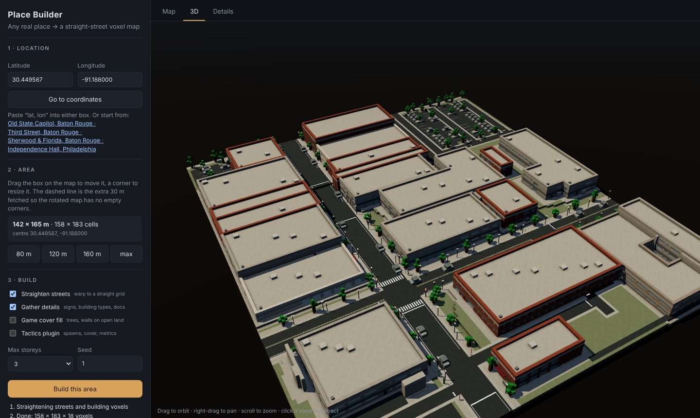
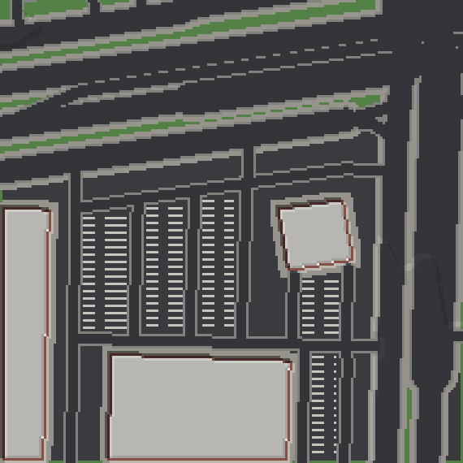
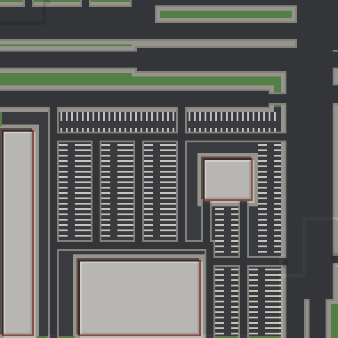
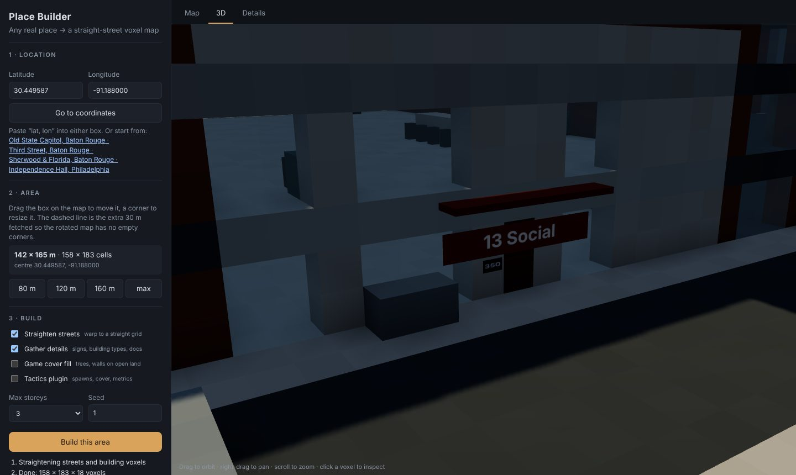
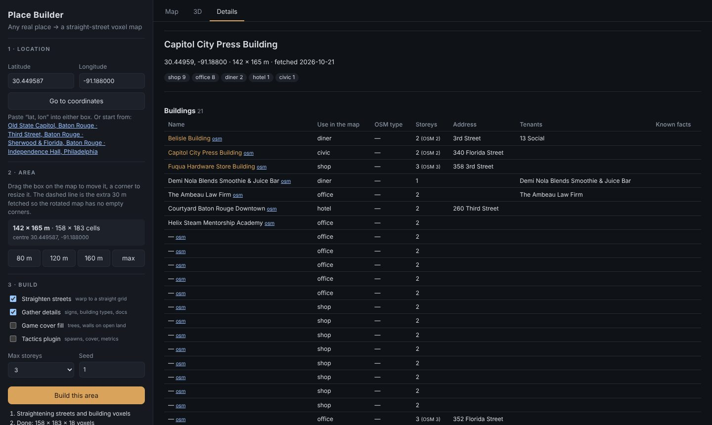

# Map Interior Generator

*Formerly Geo-voxel. The repository is being renamed to `map-interior-generator`.*

**Real map data → buildings you can walk into.** Pick any place on Earth. Map Interior Generator reads what open data says about
each building there: its outline, its use, its storeys, the street it faces, the neighbours it shares walls with and,
where one exists, its public record. From that it generates the inside: a room programme, a floor plan for every
storey, doors, windows, stairs, a roof and furniture, all checked against building-code rules. You get BIM models
(IFC4), a JSON file per building for game engines, blueprints, and furnished voxel maps of whole streets.

The floor plans follow Merrell, Schkufza & Koltun, *Computer-Generated Residential Building Layouts* (SIGGRAPH Asia
2010), adapted to a harder case: the outline is fixed by the map, not designed. Generation is deterministic and uses
no AI model.



> **Status — moving to 3D modelling only.** The project began as the map generator of a voxel tactics game. The voxel
> maps, the town engine and every game rule are moving to the game's repository (voxel-tactics), which converts
> this project's downloads into voxels with its own converter. Map Interior Generator keeps the map-to-model side: planned buildings
> and interiors in FreeCAD/IFC4, area scenes in Blender/glTF, and an installable Python package. Until that lands, the
> voxel sections below still describe the code in this repository. See
> [PLAN-geo-voxel-02](docs/plans/PLAN-geo-voxel-02.md).

## What you get

| Output | Per | Format | Opens in |
|---|---|---|---|
| Building model | building | IFC4, FreeCAD `.FCStd` | FreeCAD BIM, Blender (Bonsai), IfcOpenShell, other IFC tools |
| Game export | building | `building-export@1` JSON: rooms, doors (which rooms they join, facing, swing), windows, stairs, furniture, garage, in local metres and lat/lon | any engine |
| Blueprint | storey | SVG in the house viewer | browser |
| Gate report | building | JSON: every design check and its result | — |
| Voxel map | street (30–172 m) | `.vox`, `.glb`, `map.json`, `grid.json` | MagicaVoxel, Blender, Godot, Unity, Unreal |

## Who it is for

| You are | What Geo-voxel gives you | Start at |
|---|---|---|
| **A game or simulation developer** who wants real places with enterable, navigable buildings | one JSON per building with a room graph, door facings and a frame to place it; meshes through IFC → glTF | [docs/INTEGRATE.md §1](docs/INTEGRATE.md#1-games-and-simulations-the-building-export) |
| **A voxel artist or voxel-game developer** | whole streets as `.vox`, with straight streets, terrain, signs and rooms | [§2](docs/INTEGRATE.md#2-voxel-maps-of-whole-streets) |
| **An AEC, BIM or digital-twin builder** | code-checked, typed IFC4 interiors for buildings that only exist as outlines in the map | [§3](docs/INTEGRATE.md#3-bim-and-digital-twins-ifc4) |
| **A researcher in procedural or architectural generation** | a full, reproducible reimplementation of Merrell et al. on real footprints, with ablations, a design gate, a scorecard and a fixed test set | [docs/FINDINGS.md](docs/FINDINGS.md), [§5](docs/INTEGRATE.md#5-porting-the-method) |
| **A mapper, planner or teacher** | a way to see what typical buildings in a place are like inside, with every inferred choice explained | the house viewer |

Generated interiors are plausible and code-checked. They are not surveys of the real buildings; say so wherever you
show them.

## Quick start

**No command line.** Open the house viewer (`https://dankcode.github.io/Geo-voxel/houses/`). Browse the example
houses, or open **World map**, go to any place, highlight 1–2 blocks and press **Request generation**. That opens a
pre-filled GitHub issue; the repository's workflow generates the houses for requests the owner approves and
republishes the site. Each building has a 3D view, blueprints, its checks and a **Game export** button.

**Voxel maps in the browser:**

```sh
git clone https://github.com/Dankcode/Geo-voxel && cd Geo-voxel
npm install
npm run app            # → http://localhost:5180 (Place Builder) and /houses/ (house viewer)
```

**Houses on your own machine:**

```sh
micromamba create -f architecture/environment.yml && micromamba activate houses
bash architecture/pipeline/roofgen/build.sh
python architecture/pipeline/generate_area.py --lat 30.3916 --lon -91.2061 --blocks 1.5 --id my-area
python architecture/build_viewer.py
```

[docs/INTEGRATE.md](docs/INTEGRATE.md) explains how to use each output in your own project: coordinate frames,
building a navigation graph, engine axes, IFC conversion, forking the generator, and the licences.

## What is new here

The full discussion, with formulas and evidence, is in [docs/FINDINGS.md](docs/FINDINGS.md). In short:

1. **Fixed outlines turn the paper inside out.** Merrell et al. design the outline; on a map it is given. Daylight,
   the street entry and garage access become constraints on particular edges of the footprint.
2. **Fidelity to the paper beats improvements to it.** Each of our departures (normalising the corner count, exempting
   halls from the dimension term, adding non-paper terms to the objective, testing windows at one point) produced a
   specific defect: irregular rooms, 70 m² halls, stairs that go nowhere, roofs that don't meet. Restoring the paper's
   terms fixed each one.
3. **Adjacency is not access.** The paper's accessibility term passes plans joined through a 0.4 m neck. We test
   circulation by morphological erosion with a 914 mm disc, $W_d = \Omega \ominus B_{d/2}$, on the real wall solids,
   and charge narrow strips inside the optimiser.
4. **On a fixed outline the start state decides what is reachable.** A street-to-back "rows" start (public row, hall
   spine, private row, small rooms attached to their parent) plus programme edges relaxed to classes doubled the pass
   rate (7 → 14 of 25) and cut missing connections from 20 to 5.
5. **A footprint is not a house size.** OSM outlines include garages and patios; calibrating rooms on public records
   took a modelled 4,736 sq ft five-bedroom house back toward its recorded 1,838 sq ft and three bedrooms.
6. **Design in vectors, voxelise last.** At 0.9 m voxels a typical room loses about 40% of its area to one-cell walls;
   $A_{\text{vox}}/A \approx (1 - (c - t)/a)^2$ predicts the measured 37–46%. At 0.3 m the loss is 9–18%.
7. **An independent rebuild catches what self-checks miss.** Rebuilding every design in a second BIM modeller found
   walk-through bedrooms and a hall merged with a stair that our own gate had passed.
8. **For high-rises, height decides the plan.** With 3.0 m storeys, $n_{\max} = \lfloor (H^\ast - 0.3)/3 \rfloor$ puts
   Chinese code thresholds at 10, 17 and 33 storeys; the core, exits and refuge floors follow from the storey count.

## How it works

### Buildings (`architecture/`)

```
OpenStreetMap footprint + tags, neighbours, streets, land use, historic districts, Wikidata, public records
  → frame       walls axis-aligned, front toward the street, party walls marked          (mapctx.py)
  → theme       archetype, era and style, each with its evidence                          (theme.py)
  → programme   rooms, area and aspect priors, tiers, edge classes                        (programs.py, house_facts.py)
  → plan        Metropolis–Hastings on a 0.4 m label grid per storey                      (planner.py)
  → gate        21 checks on the built walls; restart until one passes                    (blueprint.py, circulation.py)
  → compile     doors near corners with swings, windows, stairs, straight-skeleton roofs  (doors2.py, openings.py, stairs.py, roofs.py)
  → furnish     legal poses proposed, Merrell 2011 cost chooses                            (furnish2.py)
  → outputs     FreeCAD/IFC4 model, blueprint, gate report, game export                   (bim.py, export_game.py)
```

The plan minimises the paper's cost, with every room in the dimension term and the raw corner count in the shape term:

$$C = k_a C_a + k_d C_d + k_s C_s + k_f C_f + k_o \sum_i \big(e(F_i) - 4\big),\qquad
M_c(S) = \frac{A(H(S)) - A(S)}{A(S)} + \big(e(S) - 4\big)$$

with $k_a = 100$, $k_d = 1.5$, $k_s = 1$, $k_f = 1000$, $k_o = 0.6$, and acceptance $\min(1, e^{-\beta\Delta C})$ as
$\beta$ rises from 0.03 to 6. [architecture/README.md](architecture/README.md) documents the house pipeline,
[architecture/highrise/README.md](architecture/highrise/README.md) the high-rise apartments.

### Voxel maps (`src/`, `engine/`, `app/`)

1. **Frame**: rotate by the length-weighted $4\theta$ mean of street and wall directions,
   $\theta = \tfrac14\operatorname{atan2}\!\big(\sum w L \sin 4\alpha,\ \sum w L \cos 4\alpha\big)$, which treats
   directions 90° apart as one.
2. **Straighten**: simplify centrelines (junctions pinned), snap segments to axes, tie shared coordinates by
   union-find and solve each as a weighted least-squares mean, then rubber-sheet buildings and land use along.
3. **Build**: footprints into wings, streets by box distance, lots, terrain plateaus, shells with rooms and furniture,
   OSM 3D parts and roof shapes, trees, signs, road paint.

| Raw OSM geometry on a voxel grid | Straightened (the default) |
|---|---|
|  |  |

[docs/METHOD.md](docs/METHOD.md) covers every stage; [docs/ENGINE.md](docs/ENGINE.md) maps the engine.

| Shop fascia and house number from OpenStreetMap | The Details tab: what every building is, and the sources |
|---|---|
|  |  |

## Where the data comes from

| Source | What it gives |
|---|---|
| **OpenStreetMap** (Overpass, keyless) | building outlines and tags, streets, land use, tenants, 3D building parts, entrances, house numbers, street furniture |
| **AWS Terrain Tiles** | terrain (USGS 3DEP bare earth in the US, SRTM-class elsewhere) |
| **Wikidata, Wikipedia, Commons** | landmark facts (floors, height, style, year, architect, heritage), brand colours, documentation and photo references |
| **Public property records** | living area, bedrooms, baths and garage bays for the example houses; each design cites its sources |

Credit them when you ship anything built from them: © OpenStreetMap contributors (ODbL), USGS 3DEP (public domain),
Wikidata (CC0), Wikipedia (CC BY-SA), Commons per photo. See [DATA.md](DATA.md).

## Repository layout

```
architecture/pipeline/     house pipeline (Python): planner, gate, FreeCAD/IFC, game export, area generation
architecture/highrise/     Chinese high-rise apartments: codes, core, dwelling planner, sunlight, facades
architecture/areas/        generated areas: plans, exports, IFC models, gate reports
architecture/data/         bundled OpenStreetMap extracts (Baton Rouge)
architecture/viewer/       house viewer source; build_viewer.py → app/public/houses/
app/                       Place Builder (Vite, Three.js, Leaflet) and the published viewer
src/                       voxel map library: live fetch, frame, straighten, footprints, details, .vox export
engine/                    town engine: buildings, rooms, furniture, terrain, voxels
bin/geo-voxels.mjs         CLI for voxel maps
blender/                   optional Blender/BlenderGIS fetch stage
docs/                      FINDINGS, INTEGRATE, METHOD, ENGINE, plans/, research/
.github/                   request forms and the generate-houses and Pages workflows
```

## References

- P. Merrell, E. Schkufza, V. Koltun. *Computer-Generated Residential Building Layouts.* ACM TOG 29(6), 2010.
- P. Merrell, E. Schkufza, Z. Li, M. Agrawala, V. Koltun. *Interactive Furniture Layout Using Interior Design
  Guidelines.* ACM TOG 30(4), 2011.
- T. Germer, M. Schwarz. *Procedural Arrangement of Furniture for Real-Time Walkthroughs.* CGF 28(8), 2009.
- A. Raistrick et al. *Infinigen Indoors.* CVPR 2024.
- M. Sester. *Generalization based on least squares adjustment.* IAPRS XXXIII-B4, 2000.
- S. Cabello, M. de Berg, M. van Kreveld. *Schematization of networks.* Comput. Geom. 30, 2005.
- A. Saalfeld. *Conflation: automated map compilation.* IJGIS 2(3), 1988.
- D. Camozzato et al. *Procedural floor plan generation from building sketches.* 2015.
- D. Douglas, T. Peucker. *Algorithms for the reduction of the number of points required to represent a digitized
  line or its caricature.* 1973.

The papers are cited, not included.

## Licence

Code: MIT ([LICENSE](LICENSE)). Data: © OpenStreetMap contributors (ODbL) and the other sources in [DATA.md](DATA.md).
FreeCAD (LGPL), CGAL (GPL/LGPL) and BlenderGIS (GPL-3.0) are separate installs that this repository calls.
