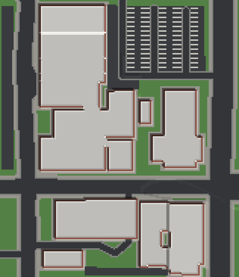
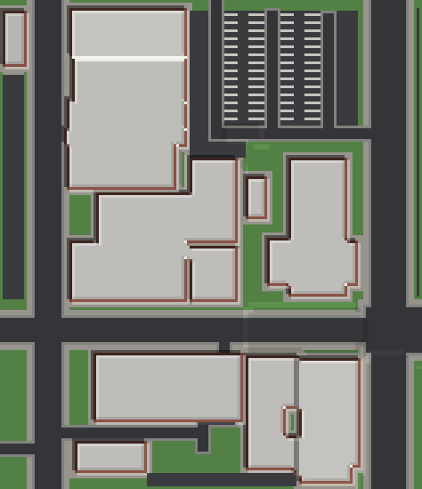
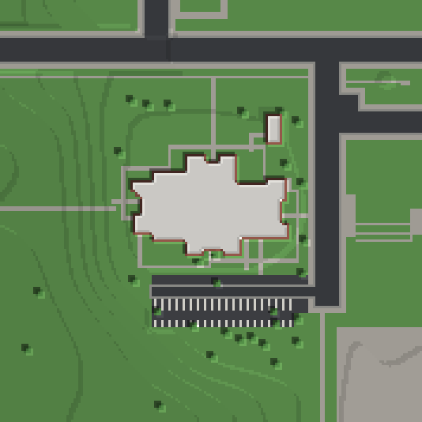
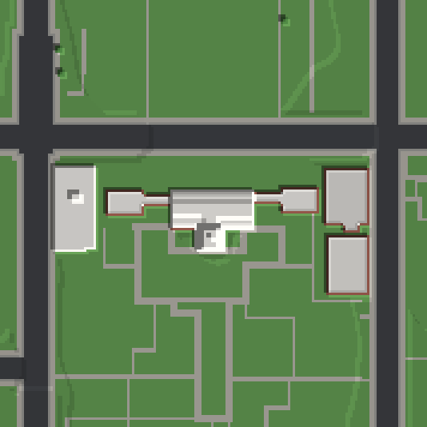
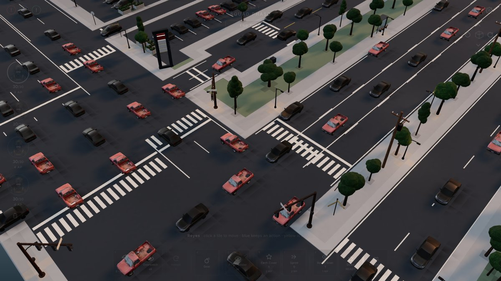

# geo-voxels

**Real places → straight-street voxel maps.** Fetch a map section (OpenStreetMap buildings, streets, land use and USGS
3DEP bare-earth terrain) through [BlenderGIS](https://github.com/domlysz/BlenderGIS) in Blender, then rebuild it at 1:1
as a voxel grid where every street is an exact grid line, every building wall lies on the grid and every height step
runs straight across the road — no ragged pixel staircases from roads that were a few degrees off north.

| Raw OSM geometry on a voxel grid | Straightened (`straighten: 'grid'`, the default) |
|---|---|
|  |  |
|  |  |

*Sherwood Forest Blvd × Florida Blvd and Third Street, Baton Rouge (examples/). Florida Blvd really meets Sherwood at
about 79°; on the straightened map it is 90° and the shopping centre slides with it.*

| Old State Capitol, Baton Rouge (Gothic Revival, lawn and paths) | Independence Hall, Philadelphia (tower from OSM 3D parts) |
|---|---|
|  |  |


*The Sherwood map in a turn-based tactics game (Three.js) — road paint from the same road graph.*

- **Engine-agnostic.** Pure JavaScript (Node ≥ 20, no dependencies). Output: a `VoxelGrid` (byte per voxel, named
  palette), MagicaVoxel `.vox`, run-length JSON, a PNG review slate, and plain-JSON layers (streets, lots, building
  wings/doors/storeys, heightfield, land use, road-paint quads) for an engine to furnish.
- **Faithful where it matters.** Real outlines (wings cut at reflex corners), real streets with lane widths, slip lanes,
  divided carriageways, real terrain (3DEP DTM, not a surface model), car parks — and strip-centre car parks inferred
  where OSM only maps retail land.
- **Context, not scraping.** One Overpass request (tenants, amenities, OSM 3D building parts, street furniture) and at
  most two Wikidata requests (floors, height, style, year, architect, heritage) per place: each building gets its real
  use and tenants, landmarks rise to their mapped parts with their roof shapes, real trees stand where they are mapped.
- **Deterministic.** The same export always gives the same grid.

## Quick start

```sh
git clone https://github.com/Dankcode/Geo-voxels && cd Geo-voxels
node bin/geo-voxels.mjs build examples/baton-rouge-sherwood-florida/blender-export.json --out out/sherwood
# → out/sherwood/map.vox, grid.json, layers.json, slate.png, report.json
npm test
```

```js
import { buildPlace, toVox } from './src/index.js';
const { grid, layers, report } = buildPlace(exportJson, { straighten: 'grid', cell: 0.9, storeyHeight: 3 });
```

## Fetching a new place (Blender + BlenderGIS)

1. Install Blender (4.x/5.x) and the BlenderGIS add-on; put your [OpenTopography](https://opentopography.org) API key in
   the add-on preferences (the key is read there — never put it in a script or repo).
2. Pick the map window in metres around a point (≤ ~230 m a side at 0.9 m cells for MagicaVoxel's 256 limit):
   ```sh
   node bin/geo-voxels.mjs blender --lat 30.4583 --lon -91.0587 --window -100,71,-97,74 --pad 30 --out ./out/place
   ```
   and run the printed Python in Blender (Scripting tab, or a Blender MCP `run_blender_python` call). It runs in the
   background (Blender stays responsive), fetches DEM and OSM for the window **plus `pad` metres on every side**, and
   writes `blender-export.json` (with a `context` block) + a top-down reference render. `context_only(out)` adds the
   context to an older export without re-fetching anything else. Overpass mirrors are retried; `resume(out, 'osm')`
   re-runs only the OSM stage.
3. `node bin/geo-voxels.mjs build out/place/blender-export.json --out out/place/map`.

Use `dem='USGS10m'` (3DEP, US, bare earth) wherever it exists. `SRTMGL1` is a *surface* model — buildings bleed into it
(downtown Baton Rouge read 21–46 m on SRTM vs 14.5–16.1 m on 3DEP).

## The method

[docs/METHOD.md](docs/METHOD.md) explains every stage. In short:

1. **Frame** — rotate by the length × class weighted 4θ mean of street segments and building walls, crop to the window
   (the padded fetch means a rotated window has real data in its corners), one uniform scale.
2. **Straighten** — Douglas–Peucker the centrelines (junctions pinned), snap each segment to an axis (true diagonals
   become an L), tie shared coordinates by union-find and solve them as the weighted least-squares mean, keeping
   parallel carriageways in order; rubber-sheet buildings and land use along; square each outline to the grid.
3. **Footprints** — rasterise, one party wall between touching buildings, cut into wing rectangles at reflex corners.
4. **Streets** — box (L∞) distance gives square road ends and corners; junction squares belong wholly to the longer
   street (nearest-wins would split them diagonally).
5. **Lots and open land** — mapped parking, implied strip-centre car parks (retail land only) with a storefront walk and
   stall rows per section; parks and grass are lawn, named plazas paved, footpaths straight paved walks.
6. **Terrain** — DTM → whole-voxel heights; buildings, lots and *each street segment* are level plateaus, touching
   plateaus ≤ 1 step apart, the rest relaxed — so height steps run straight across streets.
7. **Voxels** — ground, surfaces, shells (storeys, glazing, doors facing the street or the car park, roof, parapet),
   OSM 3D parts above the shell at their real heights with their roof shapes, real trees.
8. **Paint** — a road-paint plan (centre/lane/edge lines, stop bars, crosswalks) as quads for the renderer.

## Layout

```
blender/blender_geo_import.py   Blender stage (BlenderGIS OSM + DEM, padded window, status file, resume)
src/frame.js                    frame, rasterisation, DEM → heightfield, plateaus + relaxation
src/rectify.js                  street straightening, rubber sheet, outline squaring
src/footprint.js                outline → wings, party walls
src/osm.js                      OSM tag rules (street classes/widths, slip lanes, storeys, use)
src/context.js, src/uses.js     tenants, uses, 3D parts, Wikidata facts, street furniture per building
src/roadPaint.js                road-paint plan from the road graph
src/build.js                    buildPlace: every stage in order
src/grid.js, src/export.js      VoxelGrid, MagicaVoxel .vox, PNG slate
bin/geo-voxels.mjs              CLI
examples/                       Baton Rouge (Third Street, Sherwood & Florida, Old State Capitol) and Philadelphia
                                (Independence Hall) exports with context (OSM + Wikidata + USGS, see DATA.md)
```

## References

- D. Lysz, [BlenderGIS](https://github.com/domlysz/BlenderGIS) — OSM and DEM import into Blender.
- [OpenTopography API](https://portal.opentopography.org/apidocs/) — USGS 3DEP (`usgsdem`) and global DEMs.
- M. Sester, *Generalization based on least squares adjustment*, IAPRS XXXIII-B4 (2000) — least-squares map generalisation.
- S. Cabello, M. de Berg, M. van Kreveld, *Schematization of networks*, Comput. Geom. 30 (2005) — rectilinear schematisation.
- A. Saalfeld, *Conflation: automated map compilation*, IJGIS 2(3) (1988) — rubber-sheeting.
- D. Camozzato et al., *Procedural floor plan generation from building sketches* (2015) — outline → wings.
- D. Douglas, T. Peucker, *Algorithms for the reduction of the number of points…* (1973).

## Licence

Code: MIT ([LICENSE](LICENSE)). Example data: © OpenStreetMap contributors (ODbL) and USGS 3DEP (public domain) — see
[DATA.md](DATA.md). BlenderGIS (GPL-3.0) is a separate install; this repo only calls it.
