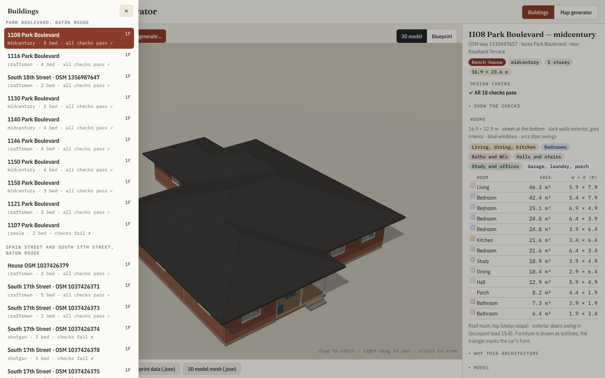
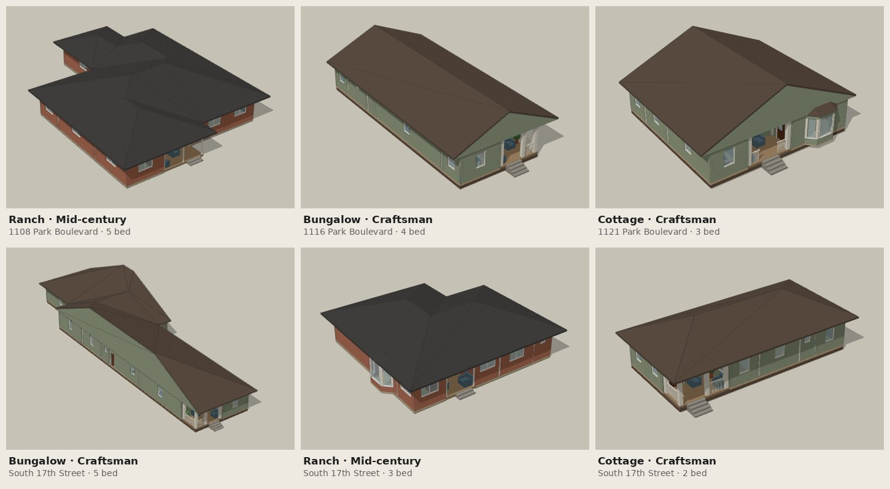
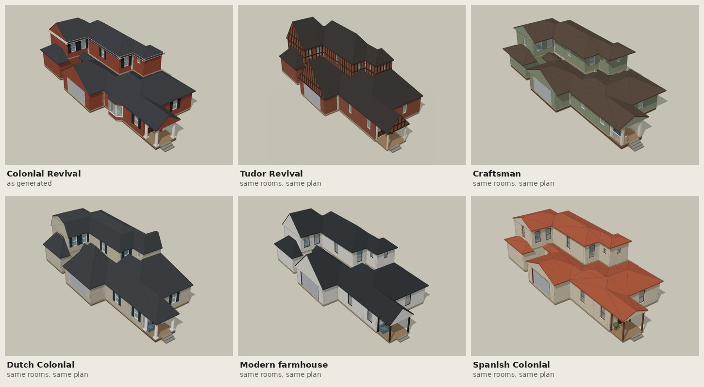
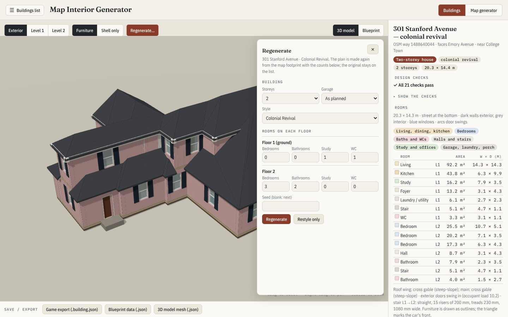

# Map Interior Generator

**Real map data → buildings you can walk into.** Pick a place on the map and the generator plans the houses in it
from its OpenStreetMap outline: rooms, floor plans, doors, windows, stairs, roof and furniture, all checked against
building-code rules. You get a 3D model (FreeCAD / IFC4), blueprints and a JSON file per building for game engines.

*Formerly Geo-voxel. Floor plans follow Merrell, Schkufza & Koltun, Computer-Generated Residential Building Layouts
(SIGGRAPH Asia 2010). No AI model is involved: the same input always gives the same building.*


## Try it

Open the viewer: **<https://dankcode.github.io/Geo-voxel/houses/>**. You can browse, cut open and export every
building there. To generate new ones you need the install below.

## Install

You need [micromamba](https://mamba.readthedocs.io/en/latest/installation/micromamba-installation.html) (or conda)
and [Node.js](https://nodejs.org) 20+. The environment file installs FreeCAD 1.0, CGAL and the Python packages.

```sh
git clone https://github.com/Dankcode/Geo-voxel && cd Geo-voxel
micromamba create -f architecture/environment.yml && micromamba activate houses
bash architecture/pipeline/roofgen/build.sh     # builds the roof tool
npm install
npm run app                                     # → open http://localhost:5180/houses/
```

Run `npm run app` from a terminal where the `houses` environment is active (or set
`GEO_VOXEL_PYTHON=/path/to/envs/houses/bin/python`). The viewer's buttons then run the generator on your computer.

## How to use it

### 1. Pick a building

Press **☰ Buildings list** and click a building. Drag to orbit, right-drag to pan, scroll to zoom. The panel on the
right shows what the map said about it, the design checks, and every room with its size.



### 2. Look inside

**Level 1 / Level 2** cut the building open at that floor. **Furniture / Shell only** toggles the furniture.
**Blueprint** draws every floor plan; point at a room for its name and size.

| Cut open at Level 1 | Blueprint |
|---|---|
|  |  |

### 3. Generate a street

1. Open the **Map generator** tab and go to a place (type an address or a latitude, longitude, then **Go**).
2. Click the map to centre the area and set the radius (1–2 blocks). The houses inside turn red.
3. Pick a style for the whole area, or leave **Inferred per house**.
4. Press **Request generation**. A progress box follows the run; **Show it here** loads the result.


The map decides each house's type and style (ranch, bungalow, cottage, shotgun or two-storey house) and its rooms
come from its own footprint. The viewer lists two generated streets: Park Boulevard (10 houses) and South 17th Street
(8 houses, including three shotgun houses).



### 4. Same floor plan, another style

**Regenerate… → Restyle only** keeps the rooms and changes the exterior: walls, roof, windows, porch and trim. Pick
any of the 20 house styles; the checks run again on the result (on two-storey plans, Cape Cod and Italianate
currently fail them). The example houses are in the list in five or six styles each, all on one plan:



**Regenerate** (instead of Restyle only) plans the house again with the storeys, bedrooms, bathrooms, garage and style
you set.



### 5. High-rise apartments

The list also holds Chinese residential slabs of 10–34 storeys with 2, 4 or 6 flats a floor. Pick a floor with
**▾ Floor N ▴** (or the **[** and **]** keys) to see the furnished flats around the lift and stair core. Any plan can
take one of five facades: plain, modern, neo-Chinese, Art Deco or commercial.


### 6. Export

The **Save / export** bar under the model downloads:

| Button | What you get |
|---|---|
| Game export | `building-export@1` JSON: rooms, doors (which rooms they join, which way they face), windows, stairs, furniture, garage |
| Blueprint data | every floor's rooms, walls, doors, windows and furniture outlines, in metres |
| 3D model mesh | the triangles the viewer draws |

IFC4 and FreeCAD files are written on your computer when you generate:
`architecture/areas/<area>/deliver/bim/` (houses) and `architecture/highrise/buildings/<id>/` (high-rises).
[docs/INTEGRATE.md](docs/INTEGRATE.md) shows how to place them in a game engine or BIM tool.

## From the command line

The viewer's buttons run these; you can too (in the `houses` environment):

```sh
cd architecture/pipeline
python run_request.py --lat 30.4380 --lon -91.1700 --blocks 1.5          # generate the houses around a point
python run_request.py --restyle examples quailoak-s1 prairie              # same plan, another style
python run_request.py --regenerate examples stanford-s3 --rooms '{"1": {"bedroom": 4}}'   # new plan, new counts
python run_request.py --highrise hr24-140 --dwellings 4 --style art_deco  # a high-rise
```

Add `--open-in-freecad` to open the result in a running FreeCAD.

## Open the results in FreeCAD or Blender (optional)

- **FreeCAD:** install the [freecad-mcp](https://github.com/neka-nat/freecad-mcp) add-on, choose its **MCP Addon**
  workbench and press **Start RPC Server**. Each building you generate then opens in FreeCAD by itself.
- **Blender:** import a building's `.ifc` with the [Bonsai](https://bonsaibim.org) add-on.
- **AI agents** (Claude Code, Codex, Cursor…) can drive FreeCAD or Blender through those MCP servers and run the
  commands above for you, e.g. *"Generate the houses within 1.5 blocks of 30.438, −91.170 and open the first one in
  FreeCAD."* Register FreeCAD with `claude mcp add freecad -- uvx freecad-mcp`.

## Learn more

| Topic | Read |
|---|---|
| How the houses are planned (cost function, checks, styles) | [architecture/README.md](architecture/README.md) |
| High-rise apartments and the Chinese codes they follow | [architecture/highrise/README.md](architecture/highrise/README.md) |
| What is new compared with the paper | [docs/FINDINGS.md](docs/FINDINGS.md) |
| Using the outputs in games, BIM and your own project | [docs/INTEGRATE.md](docs/INTEGRATE.md) |
| The voxel map library (moving to voxel-tactics) | [docs/METHOD.md](docs/METHOD.md), [docs/ENGINE.md](docs/ENGINE.md) |

Generated interiors are plausible and code-checked, not surveys of the real buildings. Say so wherever you show them.

## Data and licence

Code: MIT ([LICENSE](LICENSE)). Map data © OpenStreetMap contributors (ODbL); terrain USGS 3DEP; landmark facts from
Wikidata and Wikipedia. See [DATA.md](DATA.md). FreeCAD (LGPL) and CGAL (GPL/LGPL) are separate installs.
