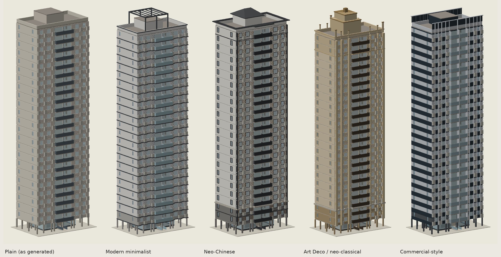

# Chinese residential high-rises

Geo-voxel's generator for Chinese high-rise apartment buildings. It works from 12 real apartment plans traced into
data and the Chinese building codes, using the Merrell et al. (2010) method adapted to high-rise floors. For
each building it plans the dwelling, sizes the core from the storey count, stacks the floors (pilotis ground floor,
typical floors, refuge floors above 100 m, roof), checks winter sunlight against the next row of blocks, scores the
result on a 1–10 card (8 = pass), and builds the whole building in FreeCAD (IFC4) and for the house viewer.

`AUDIT.md` covers how these buildings work and every problem found and fixed in the 2026-11-05 audit.

```sh
cd architecture/highrise
python test_highrise.py                       # tracing, codes, refuge floors, sunlight, gate (pure Python)
python -m highrise.analyze reference          # statistics from the traced plans
python -m highrise.generate samples           # 5 buildings: drawings, building.json, scores (about 4 min)
# 3D, in the FreeCAD environment (architecture/environment.yml):
python -m highrise.bim samples/hr24-140/building.json buildings/hr24-140          # .FCStd, .ifc, .mesh.json, .plan2d.json
python -m highrise.bim samples/hr10-120/building.json buildings/hr10-120 --no-ifc
python -m highrise.bim buildings/hr24-140/building.json buildings/hr24-140-art-deco --no-ifc --style=art_deco
python -m highrise.preview buildings/hr24-140/hr24-140.mesh.json view.png [--cut 5]
python ../build_viewer.py                     # adds buildings/* to the house viewer under "High-rise apartments (China)"
```

## Pipeline

| Stage | Module | What it does |
|---|---|---|
| Reference data | `refplans.py`, `analyze.py` | 12 traced plans (rooms, links, windows); room-size priors, band positions, who-opens-off-whom counts |
| Codes | `codes.py` | GB 55038-2025, GB 50096, GB 50016 / GB 55037, GB 50180 rules with clause numbers; height → lifts, stair, exits, lobby, refuge |
| Core | `core.py` | stair box (scissor above 54 m), fire lobby, centred lift shafts, service shafts |
| Programme | `planner.sample_programme` | conditional tables calibrated on the references (paper §4) |
| Dwelling plan | `lattice.py` + `planner.cost` | the houses' search (paper §5, `pipeline/planner.py`): a label grid on the 300 mm module over the dwelling, Merrell wall slides and room swaps, Metropolis with geometric annealing, started from the banded layout; cost = `planner.cost` (C = k_a·C_a + k_d·C_d + k_s·C_s + typology terms) + Merrell's shape measure, rooms in one piece, the houses' clear-width test and the references' zones (living room and master bedroom south, kitchen and baths off the south face). `HR_SEARCH=banded` runs the earlier banded slicing search |
| Compile | `compile.py` | doors near corners at code widths (paper §6), windows sized for daylight and ventilation, AC platforms, refuge room, mirrored second dwelling |
| Furniture | `furnish.py` | every dwelling room furnished by the houses' solver (`pipeline/furnish2.solve_room`: Germer & Schwarz poses, Merrell 2011 cost, Metropolis, 6 restarts per room) against its real walls, door clearances and windows; balconies hold a washer; a required item left out is placed by a one-level repair |
| Building | `building.py` | storey stack, pilotis ground floor with entrance hall and ramp, refuge floors, roof; programme repair when restarts fail |
| Sunlight | `sun.py`, `facade.sun_study` | hours on the Major Cold day against a row of equal blocks to the south, modelled with their parapet, roof towers and crown; smallest spacing that gives the required hours |
| Score | `score.py` | the 1–10 card (code G, core C, paper M, typology T) |
| Walls | `walls.py` | walls from room boundaries (exterior, core, party, interior) for drawings, 3D and viewer |
| Drawings | `render.py` | typical floor, ground floor, roof (SVG/PNG) |
| Exterior styles | `facade.py` | four facades on the same plan (below), checked against fire, glass and sunlight rules |
| 3D | `bim.py`, `viewer_export.py`, `preview.py` | FreeCAD model of every storey with its furniture (IfcFurniture), IFC4, viewer mesh and blueprints with furniture outlines, shaded previews |

## Results

The 12 professional reference plans score 8.96–9.88 on the card (E1 from 2017 loses points for a bedroom
against the lift, which GB 55038 4.2.3 now forbids). Generated buildings (12 restarts each, `samples/summary.json`):

| Design | Height | Core | Dwelling | GFA | Efficiency | Sun (Beijing, Major Cold day) | Score | Restarts passing |
|---|---|---|---|---|---|---|---|---|
| `hr10-120` | 10 storeys, 30.3 m | 1 lift, enclosed stair | 3 bed · 2 living · 2 bath | 117.8 m² | 82.3% | 2.7 h at 48 m spacing | **9.94** | 9/12 |
| `hr17-125` | 17 storeys, 51.3 m | 2 lifts (1 fire), smoke-proof stair | 3 bed · 2 living · 2 bath | 122.9 m² | 74.5% | 2.0 h at 60 m spacing | **9.85** | 7/12 (dropped br3) |
| `hr24-140` | 24 storeys, 72.3 m | 2 lifts (1 fire), scissor stair, refuge room per dwelling | 3 bed · 2 living · 2 bath | 137.3 m² | 76.8% | 2.0 h at 65 m spacing | **9.9** | 11/12 (dropped na, cl, st) |
| `hr33-125` | 33 storeys, 99.3 m | 2 lifts (1 fire), scissor stair, refuge room per dwelling | 3 bed · 2 living · 2 bath | 123.6 m² | 74.4% | 2.1 h at 60 m spacing | **9.8** | 6/12 |
| `hr34-125` | 34 storeys, 102.3 m | 2 lifts (1 fire), scissor stair, refuge floors 17, 33, refuge room per dwelling | 3 bed · 2 living · 2 bath | 123.6 m² | 74.4% | 2.1 h at 60 m spacing | **9.81** | 7/12 |

The test building, `hr24-140`, was built in full: 24 storeys, one pilotis ground floor and 23 typical floors (46
dwellings), plus the roof. See `buildings/hr24-140/` and the previews in `samples/hr24-140/`.

Every typical floor is furnished: 51–58 items per floor (beds, nightstands and wardrobes; sofa, armchair, coffee table
and TV unit; dining table and chairs; kitchen counter and fridge; vanity, WC and bath or shower; a washer and a plant on
each balcony), none missing. A facade style keeps its plan's furniture.

## Exterior styles

The plan fixes the rooms and windows; the facade is chosen separately. `facade.py` has the four exteriors most
common on Chinese residential high-rises. Each is built in three zones (base, body, top):

| Style | Base | Body | Top | Built examples |
|---|---|---|---|---|
| Modern minimalist (现代简约) | 2 storeys of grey stone | light render, a dark aluminium band at every slab edge, glass railings | open steel frame over the stair and lift towers | `hr24-140-modern` |
| Neo-Chinese (新中式) | 3 storeys of grey granite with a cornice | off-white walls, dark grey window surrounds and corner lines, wood-tone AC grilles | deep flat eave, hipped metal roofs on the towers | `hr24-140-neo-chinese`, `hr34-125-neo-chinese` |
| Art Deco / neo-classical (ArtDeco / 新古典) | 3 storeys of stone with a cornice | sand-coloured stone-paint, full-height pilasters, window surrounds, bronze railings | pilasters rising above the parapet in steps, a stepped crown over the core (lower on low blocks) | `hr24-140-art-deco`, `hr10-120-art-deco` |
| Commercial-style (公建化) | 2 storeys of dark granite | aluminium-panel walls, a dark enamelled panel band over every slab edge, fins beside every window, glass railings | fins carried 3.3 m above the roof with a panel screen | `hr24-140-public` |

A style never adds or removes openings, so plan scores, daylight and window-to-wall ratios are unchanged. Its own
checks (`facade.check`, stored in the variant's `building.json` and the viewer's check list):

- **F1** decorative layer class A above 50 m, at least B1 below (GB 50016 6.7.12): foam mouldings switch to GRC.
- **F2** no openings added. **F3** no fin, pilaster or surround in front of a window or door.
- **F4** sunlight re-traced with the crown on the block to the south; reports the spacing the style needs.
- **F5** the crown does not change the fire-code height (measured to the roof surface, GB 50016 A.0.1).
- **F6** no glass curtain wall on the dwelling floors (some cities ban it on new housing): dark bands are enamelled aluminium.



## Limits

Two dwellings per floor only (slab blocks); rectangular rooms; IFC elements grouped per storey and role;
sunlight against equal neighbouring blocks; 12 reference plans from north China. See `AUDIT.md` § 4.
